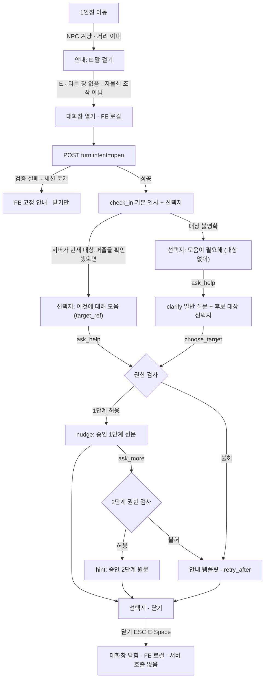

# P5-A — AI 동행 NPC 상호작용 흐름 · 인터페이스 설계 (초안 v2)

> 작성 2026-10-26 · 기준 커밋 `eafd194` · 상태 **설계 초안 — 팀 합의 전 · 커밋 전**
> 코드 · backend · frontend · 게임 콘텐츠는 바꾸지 않았다(읽기만 했다).
>
> **표기**
> - **[확인됨]** 지금 코드가 실제로 그렇게 동작한다(읽기 전용 확인 · 파일 경로 표시).
> - **[제안]** 이 문서의 설계안이다. 계약이 아니다.
> - **[합의 필요]** 팀이 정해야 한다. 정하기 전에는 구현하지 않는다(§11 표).
>
> v1 → v2 바뀐 점:
> - 오류 응답을 기존 backend 형식(`detail`)에 맞췄다(v1 의 `success/error.code` 제안은 기존 형식과 달라 버렸다).
> - `dismiss` 를 서버 요청에서 뺐다(닫기는 FE 로컬).
> - `target_ref` · 중복 요청 · 늦은 응답 · 경쟁 조건 규칙을 더했다.
> - `npc_hint_level` 을 한 가지 뜻으로 정했다. `.npc.json` 을 미승인 계약으로 표시했다.

## 0. 범위

| 단계 | 내용 | LLM | 자동 개입 |
|---|---|---|---|
| **P5-A MVP** | E 로 대화창 · 승인 템플릿 · 승인 힌트 **원문** · 닫기 | 없음 | 없음 |
| P5-A2 (이후) | A군 선택형 — 사람 평가(`docs/10`) 결과로 결정 | 선택 | 없음 |
| P5-A3 (이후) | P3 판단층 → 자동 check_in 말풍선 | 선택 | 있음 |
| **별도 작업** | NPC 3D 배치 · 따라다니기 · 애니메이션 | — | — |

- NPC 3D 배치 · 이동은 **대화 API 와 따로** 만든다. 대화 API 는 「NPC 를 겨냥하고 E」라는 입력만 가정한다. NPC 가 어디 있든, 정지해 있든 따라다니든 계약은 같다.
- **NPC 기능을 꺼도 기존 게임은 그대로 돈다**(§9). NPC 는 PlaySession 상태를 바꾸지 않는다.

## 1. 지금 코드에서 확인한 것 [확인됨]

| 영역 | 사실 | 위치 |
|---|---|---|
| FE E 키 | App 이 순서대로 처리한다: 열린 창 → 자물쇠 조작 → 들고 있는 것 → 겨냥한 것 · 상호실행 → 문. 마우스 잠금(1인칭) 중에만 먹는다 | `src/App.jsx` (keydown 처리) |
| FE 겨냥 | 화면 가운데 광선 · 거리 6 유닛(≈1.8m) · `userData.조사ID` 를 거슬러 찾는다 · 초당 약 12번 | `src/게임/조사레이.jsx` · `조사시스템.js` |
| FE 창 | 한 번에 하나만(GRD-11 · CMN-035). 창이 제 키를 듣는다. 조사창은 E 로 열고 ESC · E · Space 로 닫는다 | `src/게임/화면층.js` · `조사UI.jsx` · `힌트UI.jsx` |
| FE 서버 접속 | `모의서버` / `fetch` 를 바꿔 끼우는 구조 · 세션 상태 구독 | `src/서버/api.js` · `플레이세션.js` |
| BE 경로 | `POST /api/v1/play-sessions` · `GET /api/v1/play-sessions/{id}` · `POST /api/v1/play-sessions/{id}/interactions` | `backend/app/api/v1/` |
| BE 응답 모양 | 세션 생성 / 조회: `{success, data}` · 상호작용: **감싸지 않은** 객체(`interaction_id` · `result_type` …) | `schemas/play_session.py` · `schemas/interaction_api.py` |
| BE 오류 모양 | HTTP 상태 + `{"detail": "<문장>"}` (FastAPI `HTTPException`). 기계용 오류 코드 필드는 없다. 예: 404 `Play session not found.` · 409 `Client event ID conflicts with a previous interaction.` · 410 `Anonymous session has expired.`(세션 생성) · 422 검증 | `api/v1/interactions.py` · `docs/play_session_api.md` |
| BE 중복 처리 | 요청 처리 순서: ① PlaySession 행을 `FOR UPDATE` 로 잠근다 ② `(play_session_id, client_event_id)` 로 기존 기록을 찾는다(유일 제약) ③ 있으면 **유형 · 대상 · 본문이 같을 때만** 저장된 응답을 그대로 돌려준다. 다르면 409. 시각(`client_timestamp`)은 비교하지 않는다. 동시 삽입으로 유일 제약에 걸리면 다시 찾아 되돌려준다 | `services/interaction.py` · `models/interaction_event.py` |
| BE 상태 | `current_zone_id` · `completed_puzzle_ids` · `acquired_clue_ids` · `hint_levels`(정적 힌트) · `attempt_counts` · `flags` | `schemas/play_session.py` |
| BE 힌트 | **힌트 전용 API 는 아직 없다.** `hint_levels` 칸만 있다 | 경로 목록 |
| BE 세션 수명 | PlaySession 에 `completed_at` · 익명 세션에 `expires_at`(24시간). **상호작용 API 는 둘 다 검사하지 않는다**(존재만 확인). 일시정지 · 종료 이벤트는 없다 | `models/` · `services/play_session.py` |
| Case Bundle | FE 에 `zone_id` · `object_id` · 이름 · `visible` · `enabled` · 상호작용 **종류**만 준다. 상호작용 대상(퍼즐 ID)은 **숨긴다** | `services/case_bundle.py` |
| NPC 발화층 | `NpcContext` → `speak(…, TemplateGenerator())` → `NpcUtterance`. check_in · clarify 는 승인 템플릿 고정 · nudge / hint 는 승인 힌트 · same_level 근거 · 검증기 · 대체 · 보류 | `ai/companion_npc/src/companion_npc/speech/` |
| `.npc.json` | v0.1 **초안** — 테스트 견본 기준. **팀 승인 전 계약**이다. 결합할 때 판 고정(사건 내용 해시) · 누설 검사 · 게시 상태를 확인한다 | `contracts/npc_content.py` · `adapters/npc_merge.py` |

## 2. 상호작용 흐름 (MVP) [제안]



**흐름 규칙**

1. **open** 은 언제나 check_in 기본 인사(승인 템플릿)로 답한다.
2. open 요청의 포커스가 **서버 검증을 통과해 하나의 퍼즐**로 좁혀지면, 그 퍼즐에 대한 도움 선택지(`target_ref`)를 바로 준다. 이 선택지를 고르는 것이 「플레이어가 대상을 확인함」이다.
3. 대상이 불명확하면(포커스 없음 · 검증 실패 · 후보 여럿) 도움 요청에 **clarify + 후보 선택지**로 답한다.
   - 후보: 현재 구역 · 보이는 대상 · 안 푼 · 승인 힌트가 있는 퍼즐.
4. **마지막으로 시도한 퍼즐만으로는 포커스를 확정하지 않는다.**
   - `recent_interactions` 의 마지막 제출은 후보 **정렬**에만 쓴다. 확인은 언제나 플레이어 선택이다.
   - 같은 구역에 다른 퍼즐이 있거나, 플레이어가 이미 자리를 옮겼을 수 있다.
5. **`ask_more` 는 2단계 권한을 주지 않는다.** 서버가 매 요청마다 권한을 다시 판단한다(§4).
6. **닫기는 FE 로컬 동작이다.** 서버를 부르지 않는다.
   - 닫아도 서버 상태 · 기록이 바뀌지 않는다. 서버에 알릴 정보가 없다.
   - `dismiss` 는 서버 의도에서 뺐다. 「대화 닫음」을 분석용으로 남길지는 [합의 필요](§11).
7. E 우선순위에서 NPC 는 「겨냥한 것」 중 하나다. 다른 겨냥 대상과 같은 규칙을 쓴다. [합의 필요]

## 3. 데이터 흐름 · 신뢰 경계 [제안]

```
FE ─ 요청(의도 · 구역 · 포커스 · 보이는 대상 · target_ref) ─▶ BE
BE ① PlaySession 잠금 · 존재 · 활성 · 사건 확인
   ② 중복 요청 확인 (client_request_id)
   ③ FE 신호 검증 → 「서버 검증 공개 대상」만 남김
   ④ NpcContext 조립 (서버 상태 + 검증된 신호) · SpeechPlan (의도 → 유형 · 대상 · 확인 여부)
   ⑤ 권한 검사 (단계 · 쿨다운 · 상한 · 승인 힌트 · 공개 조건)
   ⑥ speak(…, TemplateGenerator()) → NpcUtterance → 검증 · 대체 · 보류
   ⑦ NPC 기록 저장 · 응답 저장(중복 처리용) · 커밋
BE ─ 응답(문장 · 유형 · 선택지 · target_ref) ─▶ FE
```

**신뢰 경계** — FE 가 보내는 값은 모두 **제안**이다. 서버는 다음만 발화층에 넘긴다.

| FE 값 | 서버 처리 | 발화층에 가는 것 |
|---|---|---|
| `zone_id` | 세션 `state.current_zone_id` 와 다르면 409(§7) | 세션의 현재 구역 |
| `focus.object_id` | ① 그 사건 · 현재 구역의 오브젝트인가 ② 지금 보이는가(아래 규칙) ③ 퍼즐 대상인가(서버만 아는 연결) — 하나라도 아니면 **조용히 버린다**(오류 아님) | 검증된 오브젝트 · 그 퍼즐(후보) |
| `visible_object_ids` | 현재 구역 · 지금 보이는 오브젝트와의 **교집합**만 남긴다. 모르는 ID 는 버린다(개수만 기록) | `confirmed_visible_object_ids` |
| `target_ref` | §5 규칙 — 무효면 409 | 그 참조가 가리키는 퍼즐 · `target_confirmed=true` |
| `intent` | 허용 값만(422) | 계획 유형 |

- **「지금 보이는가」의 서버 기준 [합의 필요]:** client content 의 `visible` · `enabled` 에, 상태(flag · 완료 퍼즐)로 드러나는 오브젝트를 더한다.
  - 숨은 오브젝트가 상태로 드러나는 규칙은 지금 서버 데이터에 명시돼 있지 않다.
  - 정하기 전에는 **정적 `visible=true` 만** 보이는 것으로 친다(보수적).
- **발화층에 FE 원값을 넘기지 않는다.** 발화층은 이미 「FE 가 확인한 가시성」만 이름에 쓰는 규칙이 있다(clarify). 그 입력을 서버 검증 결과로 채운다.
- FE 가 정답 · 퍼즐 ID 를 보낼 일은 없다(퍼즐 ID 는 Case Bundle 이 FE 에 숨긴다).

## 4. 발화 유형 · 권한 [제안]

| 유형 | 조건 | 문장 | `npc_hint_level` |
|---|---|---|---|
| `check_in` | `open` · 대상 없이 도움 요청을 미루는 선택 | 승인 check_in 템플릿 | 0 |
| `clarify` | 도움 요청 + 대상 미확인 · 후보 여럿 | 승인 clarify 템플릿(일반). 확인된 보이는 대상 하나면 `{object}` 템플릿 | 0 |
| `nudge` | `ask_help` + 확인된 대상 + **1단계 권한**(아래) | 그 퍼즐의 승인 1단계 힌트 원문 | 1 |
| `hint` | `ask_more` + 같은 대상 + **2단계 권한**(아래) | 그 퍼즐의 승인 2단계 힌트 원문 | 2 |
| 안내 | 권한 없음 · 힌트 없음 · 쿨다운 · 상한 | 승인 **안내 템플릿**(새 분류 · [합의 필요]) | 0 |

**권한** (서버가 매 요청 다시 판단 · 하나라도 아니면 안내)

| 권한 | 조건 |
|---|---|
| 공통 | 대상 퍼즐이 그 사건 · 현재 구역 · 안 푼 퍼즐 · 그 단계 승인 힌트가 있고 공개 조건이 열림 · `max_npc_hint_level` 이내 |
| 1단계 | 공통 + 직접 요청 쿨다운 · 상한 통과 |
| 2단계 | 공통 + **같은 퍼즐의 1단계를 이 세션에서 이미 받았음**(서버 기록) + 1단계 이후 최소 간격(제안 30초) + 상한 통과 |
| 이미 받은 단계 다시 보기 | 같은 퍼즐 · 같은 단계를 다시 청하면 **같은 승인 문장을 다시 보여 준다.** 새 정보가 아니므로 상한 · 쿨다운을 쓰지 않는다. 기록은 「다시 보기」로 남긴다 |

**`npc_hint_level` 의 뜻 (하나)** — **이 발화가 실제로 담은 NPC 힌트 단계**(0 = 힌트 없음 · 1 = 승인 1단계 원문 · 2 = 승인 2단계 원문).

- 권한도, 상한도, 정적 Hint API 의 `hint_levels` 도 아니다.
- 대체 · 보류로 힌트가 안 나가면 0 이다.

**직접 요청과 자동 개입은 쿨다운 · 상한을 따로 센다.**

| 구분 | 쿨다운 · 상한 (제안) | 근거 |
|---|---|---|
| 직접 요청(플레이어가 E · 선택) | 퍼즐당 1단계 1회 · 2단계 1회(다시 보기 제외) · 힌트 요청 사이 30초 · 세션당 힌트 발화 제한 없음(퍼즐 수가 상한) | 플레이어가 원해서 묻는 것이다. 막으면 답답하다. 단계 상한이 스포일러를 막는다 |
| 자동 개입(P5-A3 · MVP 밖) | P3 정책: 세션 3 · 퍼즐 2 · 60초 | 원하지 않은 개입은 더 아껴야 한다 |
| 둘의 관계 | 직접 요청이 자동 개입 쿨다운을 다시 시작한다(직후에 자동으로 말 걸지 않게). 반대는 아니다 | |

- 정적 힌트(USR-108 · `hint_levels`)와 NPC 힌트를 함께 셀지는 [합의 필요].

## 5. JSON 계약 초안 [제안]

**경로** — `POST /api/v1/play-sessions/{play_session_id}/npc/turns`

- 기존 `/interactions` 에 넣지 않는다. 상호작용은 **상태를 바꾸는** 행동(답 제출 · 단서 조합)이고, NPC 대화는 상태를 바꾸지 않는다.
- 같은 테이블 · 같은 중복 키를 쓰면 두 계약이 섞인다.

**요청**

```json
{
  "client_request_id": "6f1c0c1e-2b8f-4c38-9d55-0d1f2c3a4b5c",
  "client_timestamp": "2026-10-26T12:00:00+09:00",
  "intent": "open",
  "zone_id": "ZONE_EXAMPLE",
  "focus": { "object_id": "OBJ_EXAMPLE" },
  "visible_object_ids": ["OBJ_EXAMPLE", "OBJ_OTHER"],
  "target_ref": null
}
```

| 필드 | 규칙 |
|---|---|
| `client_request_id` | UUID. **NPC 대화 전용 중복 키** — 기존 `client_event_id` 와 이름 · 저장소 · 범위를 나눈다(같은 UUID 가 와도 두 계약은 서로 모른다). FE 는 두 값을 따로 만든다 |
| `client_timestamp` | 시간대 필수(기존 규칙과 같음) · 기록용 · **중복 비교에 쓰지 않는다**(기존 규칙과 같음) |
| `intent` | `open` · `ask_help` · `ask_more` · `choose_target`. `dismiss` 없음(닫기는 FE 로컬) |
| `zone_id` | 필수 · 세션 현재 구역과 대조 |
| `focus` | 선택 · 서버가 다시 찾는다 |
| `visible_object_ids` | 선택 · 최대 개수 [합의 필요](제안 32) · 서버가 교집합만 쓴다 |
| `target_ref` | `ask_help`(대상 있는 선택지) · `ask_more` · `choose_target` 에서 필수. `open` 에서는 null |
| 그 밖 | `extra=forbid` — 모르는 필드는 422(기존 규칙과 같음) |

**응답 (200)** — 감싸지 않은 객체(기존 상호작용 응답과 같은 모양 · [합의 필요]: `{success, data}` 로 감쌀지)

```json
{
  "turn_id": "c1d2e3f4-0000-4000-8000-000000000001",
  "client_request_id": "6f1c0c1e-2b8f-4c38-9d55-0d1f2c3a4b5c",
  "kind": "clarify",
  "display": "dialog",
  "text": "<승인 템플릿 문장>",
  "npc_hint_level": 0,
  "options": [
    { "intent": "choose_target", "label": "<보이는 오브젝트 이름>", "target_ref": "tr_9QmZ…" }
  ],
  "fallback": false,
  "retry_after_sec": null,
  "replayed": false
}
```

| 필드 | 뜻 |
|---|---|
| `turn_id` | 서버 발급 · 이 대화 차례 · 기록 키 |
| `kind` · `display` · `text` | 발화 유형 · 표시 방식 · 문장(`NpcUtterance` 에서 옮김) |
| `npc_hint_level` | §4 — 이 발화가 담은 NPC 힌트 단계(하나의 뜻) |
| `options` | 다음 선택지. `label` 은 Case Bundle 에 이미 있는 공개 이름만. 퍼즐 ID 는 없다 |
| `fallback` | 승인 템플릿으로 대체됐는가(사유는 보내지 않는다) |
| `retry_after_sec` | 쿨다운이면 남은 초 · 아니면 null |
| `replayed` | **이 응답이 같은 `client_request_id` · 같은 본문의 이전 요청에 대해 저장해 둔 응답을 그대로 돌려준 것인가.** true 면 새 발화 · 새 기록 · 새 권한 소모가 없다. 문장 · 선택지 · `turn_id` 는 처음과 같다. FE 는 같은 차례로 다룬다(대화창에 두 번 붙이지 않는다) |

**`target_ref` 규칙**

| 항목 | 규칙 |
|---|---|
| 발급 | 서버가 응답 `options` 에만 넣는다. 서버 쪽 표에 `(target_ref → play_session_id · puzzle_id · 발급 turn_id · 발급 시각)` 로 저장한다. 값은 추측할 수 없는 무작위 문자열(제안 128비트 · URL 안전) |
| 귀속 | 발급한 세션에서만 유효. 다른 세션의 참조는 무효 |
| 유효기간 | 제안: 발급 후 10분 · 그 세션 현재 구역이 바뀌면 무효 · 그 퍼즐이 풀리면 무효 |
| 위조 · 오래된 참조 | 표에 없음 · 다른 세션 · 만료 · 무효화 → 409 `Target reference is invalid or expired.` — **어느 이유인지, 그 퍼즐이 있는지 구분해 알리지 않는다** |
| FE 처리 | 409(대상 참조)를 받으면 대화창의 선택지를 버리고 `open` 을 다시 보낸다(새 `client_request_id`) |
| 왜 서명 토큰이 아니라 서버 표인가 | 구역 이동 · 퍼즐 완료 때 즉시 무효화할 수 있다. 발급 기록이 남는다 |

**`client_request_id` 재요청 · 충돌**

| 경우 | 결과 |
|---|---|
| 처음 | 처리 · 응답 저장 · `replayed=false` |
| 같은 ID · 같은 본문(시각 제외 · `visible_object_ids` 는 정렬해 비교) | 저장된 응답 그대로 · `replayed=true` · 200 |
| 같은 ID · **다른 본문** | 409 `Client request ID conflicts with a previous NPC turn.` — 기존 상호작용 API 와 같은 방식 |
| 동시에 같은 ID 두 번(다중 탭 · 연타) | PlaySession 잠금 + 유일 제약 → 하나만 처리 · 다른 하나는 저장된 응답을 되돌려준다(기존 처리와 같은 방식) |
| 저장 기간 | 세션이 있는 동안 [합의 필요] |

**오류 응답** — 기존 형식 `{"detail": "<문장>"}` + HTTP 상태를 따른다. 기계용 코드가 필요하면 기존 API 전체와 함께 정한다([합의 필요]).

| 상태 | `detail` (제안) | 언제 | FE 처리 |
|---|---|---|---|
| 404 | `Play session not found.` (기존 문장) | 세션 없음 | 대화창 닫기 · 기존 세션 오류 흐름 |
| 409 | `Play session is not active.` | `completed_at` 이 있음 · 익명 세션 만료(검사 여부 [합의 필요] — 지금 상호작용 API 는 하지 않는다) | 대화창 닫기 · 기존 세션 안내 |
| 409 | `Zone does not match the play session.` | `zone_id` ≠ 세션 현재 구역 | 세션 상태를 다시 받아 맞춘 뒤 `open` 다시 |
| 409 | `Target reference is invalid or expired.` | 위 표 | 선택지 버리고 `open` 다시 |
| 409 | `Client request ID conflicts with a previous NPC turn.` | 같은 ID · 다른 본문 | FE 버그 — 새 ID 로 `open` 다시 · 콘솔 경고 |
| 409 | `NPC is unavailable.` | NPC 끔 · `.npc.json` 미게시 · 판 불일치 | 대화창 대신 FE 고정 안내 · 이후 E 안내 숨김 |
| 422 | (FastAPI 검증) | 필드 · 의도 값 오류 | FE 버그 — 고정 안내 |
| 500 | `NPC turn could not be processed.` | 그 밖 | FE 고정 안내 · 재시도 1회까지 |

- **쿨다운 · 권한 없음 · 힌트 없음은 오류가 아니다.** 200 + 안내 템플릿 + `retry_after_sec` 로 답한다. 게임 안의 정상적인 대답이기 때문이다.

## 6. 시간 · 늦은 응답 · 경쟁 [제안]

| 상황 | 규칙 |
|---|---|
| FE 제한 시간 | 3초(MVP 는 템플릿 · LLM 없음). 넘으면 **같은 `client_request_id` · 같은 본문**으로 1회 재시도 → 서버가 저장된 응답을 주므로 권한이 두 번 쓰이지 않는다 |
| 재시도도 실패 | FE 고정 안내(사건 정보 없음) · 선택지 다시 열기. 다음 요청은 새 ID |
| 늦게 도착한 응답 | FE 는 「지금 기다리는 `client_request_id`」 하나만 화면에 붙인다. 그 밖의 응답(닫은 뒤 · 더 새 요청이 있음)은 버린다. 서버에는 처리 · 기록이 이미 남았을 수 있다 → 같은 단계를 다시 청하면 **다시 보기**(§4)로 같은 문장이 나오므로 플레이어가 힌트를 잃지 않는다 |
| 대기 중 입력 | 선택지 버튼을 잠근다. 대기 중 E · ESC 는 창 닫기만 한다(요청은 그대로 두고 결과는 버린다) |
| 같은 세션 동시 힌트 요청(다른 ID · 두 탭) | 처리 전체를 **PlaySession 행 잠금(`FOR UPDATE`) 아래** 한 트랜잭션으로 한다(기존 상호작용과 같은 잠금). 권한 판단 → 기록 → 커밋이 차례로 일어나므로 상한 · 쿨다운을 두 번 통과하지 못한다. 상호작용 제출과도 같은 행을 잠그므로 「답 제출 중 힌트」가 순서대로 처리된다 |
| 세션 종료 · 만료 | 409(활성 아님) — 대화창 닫기 |
| 일시정지(ESC 메뉴) | 화면층 한 칸 규칙으로 대화창이 닫힌다 · 늦은 응답은 버린다 |

## 7. 콘텐츠 · `.npc.json` [합의 필요]

- `.npc.json` v0.1 은 **팀 승인 전 계약**이다. 지금 견본은 테스트용이다.
- **게시 · 판 확인 절차 (제안)** — 서버가 사건마다 NPC 콘텐츠를 불러올 때:
  1. `contract` · `contract_version` 이 지원하는 판인가
  2. `publication.status == "published"` 이고 승인 기록(누가 · 언제)이 있는가
  3. `case_content` 의 사건 내용 해시가 **지금 서버가 쓰는 Case client / server 내용의 해시와 같은가**(사건이 바뀌면 NPC 콘텐츠가 자동으로 무효)
  4. 누설 검사(정답 · 별칭이 템플릿 · 힌트에 없음) 통과
  5. 승인 안내 템플릿(새 분류)이 있는가
  - 하나라도 아니면 그 사건의 NPC 를 **끈 것과 같게**(409 `NPC is unavailable.`) — 게임은 그대로.
  - 통과하면 `content_id` · `content_version` 을 각 대화 기록에 남긴다.
- 위 1~4 는 이 실험 환경의 결합기(`adapters/npc_merge.py`)가 이미 하는 검사다. 5 와 「게시 권한 · 배포」는 새로 정해야 한다.
- 실제 사건의 NPC 1 · 2단계 힌트는 사람이 쓰고 검수한다. 2단계가 풀이를 완결하지 않는지 본다(docs/01 #44 · #49).

## 8. 기록 [제안]

- 서버 기록(저장 위치 [합의 필요] — 제안: 새 테이블 `npc_turns`, 유일 제약 `(play_session_id, client_request_id)`)
  - `turn_id` · `client_request_id` · 요청 본문(비교용) · 저장 응답 · 의도 · 유형 · 퍼즐 ID · `npc_hint_level`
  - 승인 힌트 ID · 다시 보기 여부 · 대체 여부 · `content_id` / `content_version` · 시각
- `target_ref` 표: `npc_target_refs (target_ref · play_session_id · puzzle_id · turn_id · issued_at · revoked_at)` — 또는 같은 테이블의 칸
- MVP 는 플레이어 자유 문장을 받지 않는다 → 개인정보가 들어갈 칸이 없다. 원문 로그도 없다(문장은 승인 콘텐츠).

## 9. 기능 끄기 [제안]

- 서버 설정(제안 `NPC_ENABLED`, 사건별 덮어쓰기)이 꺼져 있으면:
  - 경로가 409 `NPC is unavailable.`
  - FE 는 시작 때 그 상태를 알면(방법 [합의 필요]) NPC 를 그리지 않거나 E 안내를 숨긴다
- NPC 는 PlaySession 상태 · 상호작용 · 정적 힌트를 바꾸지 않으므로, 꺼도 기존 흐름에 영향이 없다.
- 회귀 기준: 끈 상태에서 기존 backend · frontend 테스트가 그대로 통과한다.

## 10. 재사용 · 기존 코드와의 충돌 점검 [확인됨 / 제안]

| 재사용 | 어떻게 |
|---|---|
| FE 겨냥 · 창 · 키 규칙 | NPC 를 `조사ID` 대상으로 등록 · 화면층에 「NPC 대화」 칸 · 조사창과 같은 열기 / 닫기 |
| FE 서버 구조 | `api.js` 에 함수 하나 · `모의서버` 응답 먼저 |
| BE 세션 하위 경로 · 요청 모델 · 시간대 검사 | 같은 방식 |
| BE 중복 처리 · 행 잠금 | **같은 방식 · 다른 키 · 다른 테이블** |
| BE 오류 형식 | 같은 `detail` 형식 |
| NPC 발화층 | `speak` · `TemplateGenerator` · 검증기 · 결합기 — backend 로 옮겨야 한다(§11 AI) |

| 점검한 충돌 가능성 | 결론 |
|---|---|
| `client_event_id` 와 중복 키 | 이름 · 테이블 · 범위를 나눠 충돌 없음(`client_request_id` · `npc_turns`) |
| `/interactions` 에 NPC 를 넣기 | 넣지 않는다 — 상태 변경 계약과 섞임 |
| 오류 응답 모양 | v1 의 `success/error.code` 를 버리고 기존 `detail` 로 맞춤 |
| 성공 응답 모양 | 상호작용과 같은 「감싸지 않은 객체」 제안 · 세션 API 는 `{success, data}` 라 일관성은 [합의 필요] |
| 퍼즐 ID 노출 | Case Bundle 이 숨기는 값 → 응답에 넣지 않고 `target_ref` 로 대신함 |
| 정적 `hint_levels` | 읽기만 · 쓰지 않음 |
| 세션 활성 검사 | 지금 상호작용 API 에 없다 → NPC 만 검사하면 정책이 갈린다. 함께 정할 일([합의 필요]) |

## 11. 팀 협의 항목 (모두 **미확정**)

**FE 담당**

| 결정할 사항 | 제안 기본값 | 추천 이유 | 정하지 않으면 | 상태 |
|---|---|---|---|---|
| NPC 3D 배치 · 이동 | 대화 API 와 별도 작업 · 처음엔 고정 위치 | 대화 계약이 위치와 무관 · 따라다니기는 충돌 · 경로 문제가 커서 따로 검증 | 대화창을 시험할 대상이 없다 | 미확정 |
| E 우선순위 자리 | 「겨냥한 것」 중 하나(조사 대상과 같은 규칙) | 새 갈래를 만들지 않는다 · 안내문 순서와 맞음 | 들고 있는 물건과 E 가 겹쳐 오동작 | 미확정 |
| 대화창 UI | 화면층 새 칸 · 조사창과 같은 옷 · 선택지 최대 4 | 한 번에 한 창 규칙 · 학습 비용 없음 | 창이 겹치거나 닫는 법이 달라 혼란 | 미확정 |
| `visible_object_ids` 생성 | 현재 구역에서 그려진 조사 대상 중 화면 · 거리 안의 것 | 서버가 교집합만 쓰므로 넉넉해도 안전 | clarify 가 이름을 못 써 늘 일반 질문 | 미확정 |
| 포커스 값 | 지금 겨냥(`겨냥`) · 없으면 null(최근 조사창은 보내지 않음) | 「지금 보는 것」만이 포커스다 · 지난 것은 섞지 않는다 | 엉뚱한 퍼즐을 대상으로 제안 | 미확정 |
| 제한 시간 · 재시도 | 3초 · 같은 ID 1회 | 템플릿 MVP 는 빠르다 · 중복 처리로 안전 | 대기가 끝나지 않거나 힌트가 두 번 쓰임 | 미확정 |
| 실패 고정 문구 | 「잠시 후 다시 말을 걸어 주세요」 류(사건 정보 없음) | FE 가 사건 내용을 지어내지 않는다 | 실패 때 빈 창 | 미확정 |
| NPC 끔 상태 받기 | 세션 시작 응답 · 설정 조회 중 하나 | E 안내를 미리 숨길 수 있다 | 끈 상태에서 E 를 눌러야 안다 | 미확정 |

**BE 담당**

| 결정할 사항 | 제안 기본값 | 추천 이유 | 정하지 않으면 | 상태 |
|---|---|---|---|---|
| 경로 | `POST /play-sessions/{id}/npc/turns` | 세션 하위 · 상호작용과 분리 | FE 가 붙일 곳이 없다 | 미확정 |
| 성공 응답 모양 | 감싸지 않은 객체(상호작용과 같음) | 가장 가까운 이웃 API 와 맞춤 | FE 파싱이 갈린다 | 미확정 |
| 오류 형식 | 기존 `detail` + 상태 · 문장은 §5 | 새 형식을 만들지 않는다 | 오류 처리가 API 마다 다름 | 미확정 |
| 기계용 오류 코드 | 지금은 없음 · 필요하면 전 API 함께 | 한 API 만 다르면 더 헷갈린다 | FE 가 문장으로 분기(취약) | 미확정 |
| 기록 저장 | 새 테이블 `npc_turns` · 유일 `(play_session_id, client_request_id)` | 상호작용 기록과 섞지 않는다 · 중복 처리 · 쿨다운 계산 | 중복 · 상한을 구현할 수 없다 | 미확정 |
| `target_ref` | 서버 표 · 10분 · 구역 이동 · 완료 시 무효 · 409 | 즉시 무효화 · 위조 방지 · 퍼즐 ID 비노출 | 퍼즐 ID 를 FE 에 줘야 한다 | 미확정 |
| 동시성 | PlaySession `FOR UPDATE` 아래 처리 | 기존 상호작용과 같은 잠금 · 상한 경쟁 없음 | 두 탭에서 상한을 넘는다 | 미확정 |
| 세션 활성 판단 | `completed_at` 없음 + 익명 세션 미만료 · **상호작용 API 와 함께** 적용 | 한 API 만 다르면 정책이 갈린다 | 끝난 세션에서 힌트가 나온다 | 미확정 |
| 「지금 보이는가」 | 정적 `visible=true` 만(드러남 규칙 정할 때까지) | 숨은 대상 노출 위험이 가장 작다 | 숨은 오브젝트 이름이 선택지에 나올 수 있다 | 미확정 |
| 기능 끄기 | 설정 `NPC_ENABLED` + 사건별 · 409 | 게임과 독립 · 즉시 끔 | 문제 시 배포 없이 끌 수 없다 | 미확정 |
| 발화층 이전 | 패키지로 옮김 · Python 3.13 호환 확인 · 의존성 최소(템플릿 경로는 scikit-learn 검색만) | MVP 에 LLM · SDK 불필요 | 서버에서 발화층을 부를 수 없다 | 미확정 |

**기획 · 콘텐츠 담당**

| 결정할 사항 | 제안 기본값 | 추천 이유 | 정하지 않으면 | 상태 |
|---|---|---|---|---|
| `.npc.json` 계약 · 게시 | §7 절차 · 사건 내용 해시 고정 | 사건이 바뀌면 자동 무효 · 누설 검사 | NPC 를 켤 수 없다 | 미확정 |
| 실제 사건 NPC 힌트 | 퍼즐마다 1단계(어디) · 2단계(무엇 · 어떻게, 정답 없음) · 사람 검수 | MVP 는 원문을 그대로 보인다 | 보여 줄 문장이 없다 · 과한 2단계가 그대로 나간다 | 미확정 |
| 안내 템플릿 문구 | 힌트 없음 · 쿨다운 · 상한용 각 1~2개 | 정상 응답도 승인 문장이어야 한다 | 쿨다운 때 빈 말 | 미확정 |
| 직접 요청 상한 | 퍼즐당 1 · 2단계 각 1회 · 30초 · 다시 보기 무제한 | 원해서 묻는 사람을 막지 않는다 · 단계 상한이 보호 | 과하거나 인색한 힌트 | 미확정 |
| 2단계 조건 | 같은 퍼즐 1단계를 받은 뒤 30초 | `ask_more` 가 곧바로 2단계가 되지 않게 | 첫 질문에 2단계가 나간다 | 미확정 |
| 정적 힌트와의 관계 | 따로 센다 · 서로 바꾸지 않는다 | 책임 분리(정적 Hint API 는 backend) | 같은 퍼즐에 힌트가 겹쳐 쌓임 | 미확정 |
| 「대화 닫음」 분석 기록 | 남기지 않음(MVP) | 서버 호출 없이 닫는다 | 대화 이탈 분석 불가(MVP 영향 작음) | 미확정 |

## 12. MVP 구현 순서 · 완료 기준(DoD) [제안]

| 순서 | 작업 | 완료 기준 |
|---|---|---|
| 0 | §11 합의 · 이 문서 「확정」 갱신 | 경로 · 응답 · 오류 · 기록 · `target_ref` · 활성 판단 · 보이는가 기준이 확정 표시 |
| 1 | 콘텐츠 | 대상 사건 `.npc.json` 게시 · 판 고정 · 누설 검사 · 2단계 검수 · 안내 템플릿 |
| 2 | 발화 서비스(템플릿 전용 · backend 로 이전) | 요청 → NpcContext → speak(Template) → 응답 단위 테스트(권한 · 다시 보기 · 대체 · 보류 · 정답 / 퍼즐 ID 미노출 · LLM 경로 없음) |
| 3 | BE 경로 | 신뢰 경계 · 중복(같은 / 다른 본문) · `target_ref`(위조 · 만료 · 다른 세션) · 잠금 경쟁 · 활성 · 끄기 · 오류 형식 테스트 · 기존 API 회귀 없음 |
| 4 | FE 대화창 | 겨냥 → E → 열기 / 닫기(로컬) · 화면층 · 선택지 · 대기 잠금 · 3초 · 같은 ID 재시도 · 늦은 응답 버림 · 409 처리 · 모의서버로 동작 |
| 5 | 통합 | 실제 서버로 check_in → (clarify) → 대상 → nudge → hint → 닫기 · 연타 / 재시도에도 기록 하나 · 두 탭 경쟁에서 상한 유지 · 종료 세션 거절 |
| 6 | 안전 | 응답 · 기록 · 네트워크에 정답 · 별칭 · 퍼즐 ID · 근거 ID 없음 · LLM 호출 0 |
| 7 | 끄기 · 회귀 | NPC 끔에서 기존 게임 · 테스트가 그대로 |
| (별도) | NPC 3D 배치 · 따라다니기 | 대화 계약과 독립 검증 |
